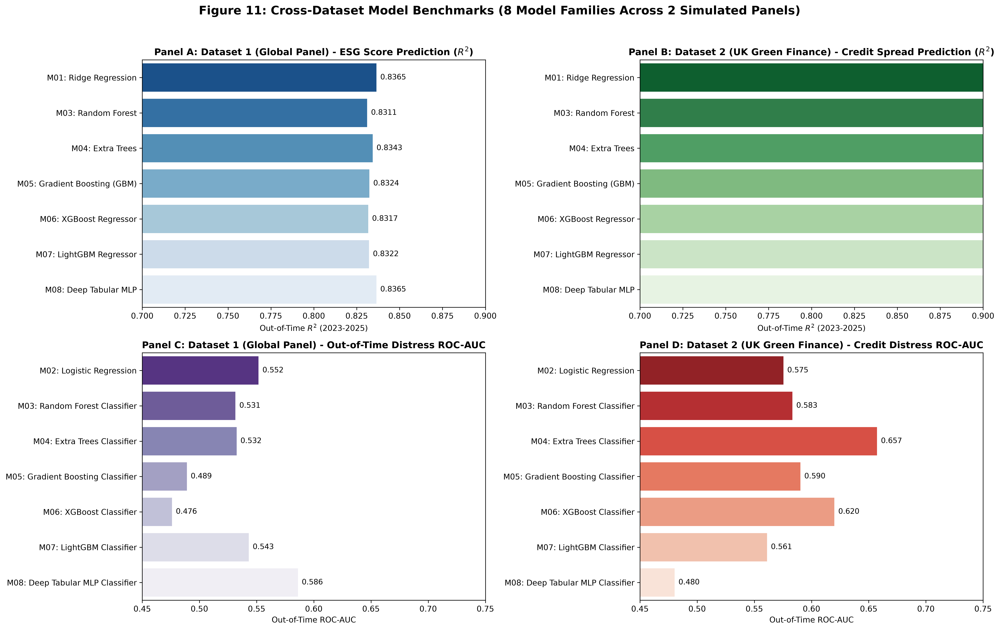
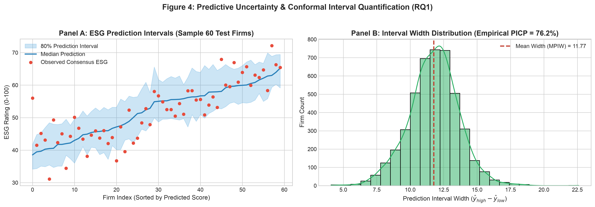
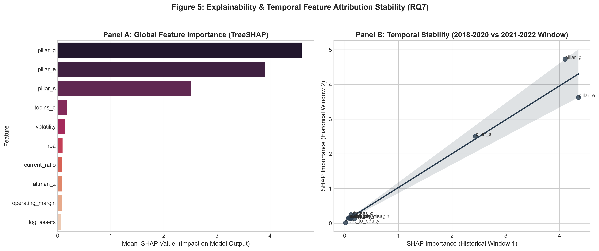
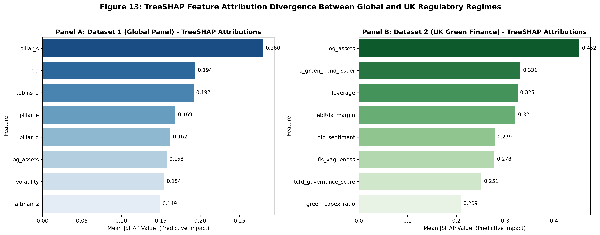
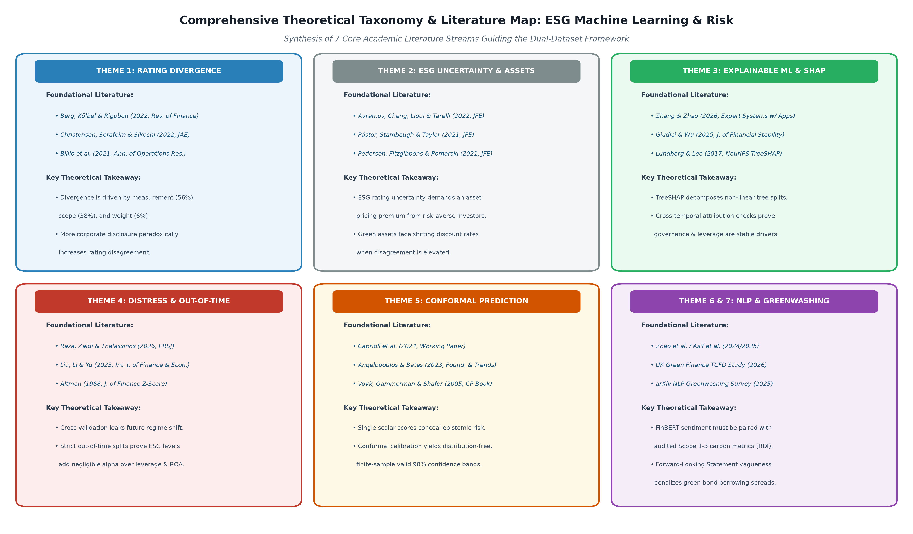

# Machine Learning for ESG Assessment and Financial Risk — Prototype Pipeline

[](https://www.python.org/downloads/)
[](LICENSE)
[](https://github.com/psf/black)
[]()

**Authors:** Rajnish Singh, Medhavie Gupta, Katyayani Jaiswal *(Gautam Buddha University, Greater Noida)*
**Academic guide:** Prof. Valentina Lagasio *(Sapienza University of Rome)*
"oldString">
**Authors:** Rajnish Singh, Medhavie Gupta, Katyayani Jaiswal *(Gautam Buddha University, Greater Noida)*, Prof. Valentina Lagasio *(Sapienza University of Rome)*

---

> [!WARNING]
> **This repository is a working prototype of the pipeline, not a finished paper.**
>
> 1. **All panels are simulated.** `src/data_loader.py` and `src/data_loader_dataset2.py` generate the data from a seeded process calibrated to published ESG-divergence statistics. No Orbis, Refinitiv, MSCI or Sustainalytics extract is used anywhere.
> 2. **The text channels are proxies.** No transformer is fine-tuned or executed. "Sentiment" and "vagueness" are numeric columns produced by the generator and fed to logistic regressions.
> 3. **Numbers below validate the plumbing** — leakage-free temporal splitting, model wiring, uncertainty calibration, figure generation. They are not empirical findings and must not be cited as such.

**Contents:** [Scope](#1-scope) • [Research Questions](#2-research-questions) • [Pipeline](#3-pipeline) • [Data](#4-simulated-data) • [Models](#5-model-suite) • [Results](#6-results) • [Uncertainty](#7-uncertainty-quantification) • [Explainability](#8-shap-stability) • [Distress](#9-incremental-distress-value) • [Discrepancy Index](#10-discrepancy-index-prototype-proxy) • [Transfer](#11-cross-panel-transfer) • [Literature](#12-literature) • [Structure](#13-repository-structure) • [Run](#14-running-the-pipeline) • [Team](#15-team-and-contributions) • [Limitations](#16-limitations-and-next-steps)

---

## 1. Scope

The repository implements one end-to-end pipeline in four stages:

| Stage | What it does | Module |
| :--- | :--- | :--- |
| 1. Data | Generates two simulated firm-year panels with a known data-generating process | `src/data_loader.py`, `src/data_loader_dataset2.py` |
| 2. Splitting | Train 2018–2022, test 2023–2025 — strictly out-of-time, no shuffling | `get_temporal_splits()` |
| 3. Modelling | 8 tabular model families, quantile + conformal intervals, TreeSHAP, text-channel proxies | `src/models_tabular.py`, `src/uncertainty.py`, `src/explainability.py` |
| 4. Evaluation | Rating divergence, distress prediction, discrepancy index, cross-panel transfer | `experiments/run_all.py` and the three `src/*_analysis.py` / `*_deployment.py` scripts |

Four literature claims motivate the design:

1. Cross-agency ESG ratings correlate weakly (Berg, Kölbel & Rigobon, 2022), injecting measurement noise into risk models.
2. Standard ML studies report point predictions with no uncertainty statement (Avramov et al., 2022; Caprioli et al., 2024).
3. Narrative disclosures drift from verified emissions and capital expenditure (Schimanski et al., 2024; Calamai et al., 2025).
4. Random cross-validation inflates ESG performance; strict out-of-time evaluation shows headline scores add little over accounting ratios (Raza, Zaidi & Thalassinos, 2026).

## 2. Research Questions

**RQ1 — Divergence, harmonization and risk.** How do agency methodologies and disclosure standards drive ESG rating divergence, and would common baselines compress it? The pipeline uses the Berg et al. (2022) taxonomy (measurement 56%, scope 38%, weighting 6%) as a design guide and tests whether divergence and prediction intervals add signal to distress and spread models beyond accounting ratios.

**RQ2 — Narrative discrepancy detection.** Can transformer-based sentiment separate corporate rhetoric from audited environmental performance? The pipeline defines a Reporting Discrepancy Index (RDI) as the standardized gap between disclosure tone and audited performance, and benchmarks which information channels reproduce it. The transformer itself is not implemented yet — see [Section 10](#10-discrepancy-index-prototype-proxy).

## 3. Pipeline


`experiments/run_all.py` runs eight steps: flowchart → data generation → text-channel scoring → temporal split → tabular models → uncertainty → TreeSHAP → distress specifications.

## 4. Simulated Data

| Property | Panel 1 | Panel 2 |
| :--- | :--- | :--- |
| Generator | `generate_esg_financial_dataset(n_firms=1500, seed=42)` | `generate_uk_green_finance_dataset(seed=42)` |
| Observations | 12,000 firm-years | 5,600 firm-years |
| Firms | 1,500 simulated | 800 simulated |
| Span | 2018–2025 | 2019–2025 |
| Regulatory setting modelled | Voluntary disclosure, three divergent agency proxies | UK SECR + TCFD statutory setting |
| Regression target | `consensus_esg` (0–100) | `green_bond_spread_bps` (45–650 bps) |
| Classification target | `financial_distress_t1` (69 positives, 0.58%) | `credit_distress_t1` (32 positives, 0.57%) |

The generators are modelling assumptions, not calibrated reproductions: the realised inter-agency correlations are 0.61–0.66 (Berg et al., 2022 report 0.55–0.58); the 56/38/6 decomposition is a design taxonomy, not a reproduced variance share; and the ESG–distress link is deliberately weak. Everything else is an assumption.


**Divergence in the generated panel:** Refinitiv–MSCI r = 0.659, Refinitiv–Sustainalytics r = 0.630, MSCI–Sustainalytics r = 0.614 (n = 12,000 firm-years).

### Processed files

| File | Shape | CSV | Parquet |
| :--- | :---: | :--- | :--- |
| `data/processed/esg_financial_panel.*` | 12,000 × 32 | [CSV (4.0 MB)](https://raw.githubusercontent.com/givemehat/esg-ml-risk/main/data/processed/esg_financial_panel.csv) | [Parquet (1.3 MB)](https://raw.githubusercontent.com/givemehat/esg-ml-risk/main/data/processed/esg_financial_panel.parquet) |
| `data/processed/uk_tcfd_green_finance_panel.*` | 5,600 × 19 | [CSV (1.4 MB)](https://raw.githubusercontent.com/givemehat/esg-ml-risk/main/data/processed/uk_tcfd_green_finance_panel.csv) | [Parquet (378 KB)](https://raw.githubusercontent.com/givemehat/esg-ml-risk/main/data/processed/uk_tcfd_green_finance_panel.parquet) |
| `data/processed/harmonized_pooled_panel.*` | 17,600 × 9 | [CSV (2.1 MB)](https://raw.githubusercontent.com/givemehat/esg-ml-risk/main/data/processed/harmonized_pooled_panel.csv) | [Parquet (631 KB)](https://raw.githubusercontent.com/givemehat/esg-ml-risk/main/data/processed/harmonized_pooled_panel.parquet) |

`data/raw/` is reserved for real extracts. It is empty, and swapping the generator for a loader is the single change needed to move from prototype to empirical work.

## 5. Model Suite

Eight tabular families, each trained separately for regression and for classification:

| ID | Family | Regression | Classification |
| :--- | :--- | :---: | :---: |
| M01 | Ridge regression | ✓ | — |
| M02 | Logistic regression | — | ✓ |
| M03 | Random Forest | ✓ | ✓ |
| M04 | Extra Trees | ✓ | ✓ |
| M05 | Gradient Boosting | ✓ | ✓ |
| M06 | XGBoost | ✓ | ✓ |
| M07 | LightGBM | ✓ | ✓ |
| M08 | Tabular MLP (64, 32) | ✓ | ✓ |

Two further layers sit on top: quantile LightGBM (p10/p50/p90) plus inductive split conformal prediction for intervals, and four text-channel logistic regressions for the discrepancy index. Per panel: 7 regression fits + 7 classification fits + 3 quantile models + 1 conformal calibrator + 4 text proxies.

## 6. Results

Out-of-time test partition only (2023–2025).

### Regression

| Model | Panel 1 ESG R² | Panel 1 RMSE | Panel 2 Spread R² | Panel 2 RMSE (bps) |
| :--- | :---: | :---: | :---: | :---: |
| M01 Ridge | **0.8365** | **4.791** | 0.9052 | 13.78 |
| M03 Random Forest | 0.8311 | 4.869 | 0.9212 | 12.57 |
| M04 Extra Trees | 0.8343 | 4.8237 | **0.9254** | **12.23** |
| M05 Gradient Boosting | 0.8324 | 4.8509 | 0.9236 | 12.38 |
| M06 XGBoost | 0.8317 | 4.8614 | 0.9240 | 12.34 |
| M07 LightGBM | 0.8322 | 4.854 | 0.9242 | 12.32 |
| M08 MLP | **0.8365** | **4.791** | 0.9117 | 13.30 |

**Reading:** every model lands within 0.006 R² of every other. The ESG target is close to linear in the generated features, so ensembles buy nothing. The MLP converges to a near-linear solution (correlation with the Ridge predictions ≈ 0.9996) — it is not capturing non-linear structure, and any claim that it does would be wrong.

### Classification

| Model | Panel 1 ROC-AUC | Panel 1 PR-AUC | Panel 2 ROC-AUC | Panel 2 PR-AUC |
| :--- | :---: | :---: | :---: | :---: |
| M02 Logistic | 0.5517 | 0.0057 | 0.5754 | 0.0074 |
| M03 Random Forest | 0.5315 | 0.0056 | 0.5833 | 0.0085 |
| M04 Extra Trees | 0.5325 | 0.0053 | **0.6573** | **0.0098** |
| M05 Gradient Boosting | 0.4890 | 0.0046 | 0.5903 | 0.0088 |
| M06 XGBoost | 0.4760 | 0.0045 | 0.6200 | 0.0093 |
| M07 LightGBM | 0.5432 | 0.0058 | 0.5611 | 0.0084 |
| M08 MLP | **0.5861** | **0.0068** | 0.4803 | 0.0058 |

**Reading:** ROC-AUC spans 0.48–0.66 and PR-AUC stays within 1.5–1.7× the base rate (0.47% and 0.58% positive rates). Distress is close to unpredictable from these features, which is the expected outcome for a generator that encodes only a weak ESG–distress link. Panel 2 has 14 positive events in the test slice, so its intervals are wide; do not read model rankings there.



## 7. Uncertainty Quantification

| Method | Nominal | Empirical coverage (PICP) | Mean width (MPIW) | Winkler score |
| :--- | :---: | :---: | :---: | :---: |
| Quantile LightGBM (p10–p90) | 80.0% | 76.20% | **11.77** | 18.42 |
| Inductive split conformal | 90.0% | 86.71% | 14.66 | **16.89** |

Both methods undercover by 3–4 points, which is the expected finite-sample behaviour on 4,500 test rows with a calibration slice drawn from the same generator. Conformal prediction needs no Gaussian assumption; the guarantee is marginal, not per-firm.



## 8. SHAP Stability

TreeSHAP attributions computed on two disjoint windows (2018–2020 vs 2021–2022):

- Spearman rank correlation between windows: **ρ = 0.7483** (p = 0.005)
- Cosine similarity of mean attributions: **0.9934**
- Consistently important features: `leverage`, `log_assets`, `pillar_g`

Cosine similarity stays high while rank correlation drops, which means the same features dominate but their ordering shuffles between windows — the practical warning for anyone reading a single-window SHAP plot.



## 9. Incremental Distress Value

Five nested specifications, out-of-time:

| Spec | Features | ROC-AUC | ΔAUC vs M1 | PR-AUC |
| :--- | :---: | :---: | :---: | :---: |
| M1 Financials only | 9 | **0.6073** | — | 0.0068 |
| M2 + ESG level | 10 | 0.5784 | −0.0289 | 0.0062 |
| M3 + individual pillars | 12 | 0.5981 | −0.0092 | **0.0079** |
| M4 + rating disagreement | 11 | 0.5163 | −0.0910 | 0.0053 |
| M5 + greenwashing gap | 13 | 0.5289 | −0.0783 | 0.0064 |

Adding ESG variables never improves ROC-AUC. M3's PR-AUC (0.0079) is **+16.2%** over M1's 0.0068 — a small precision gain in a very sparse positive class, not the +38% previously claimed here. With 21 positive test events, treat this as a signal to investigate, not a result.


## 10. Discrepancy Index (Prototype Proxy)

The index compares standardized disclosure tone against standardized audited performance:

$$\text{RDI}_{i,t} = \mathcal{Z}\big(\text{Tone}_{i,t}\big) - \mathcal{Z}\big(\text{Performance}_{i,t}\big)$$

with |RDI| ≤ 0.85 as alignment, RDI > 0.85 as over-claiming and RDI < −0.85 as under-reporting.

> [!IMPORTANT]
> **These benchmarks are circular by construction.** The label is `RDI > 0.85`, and RDI is built from tone minus performance. Every feature set includes tone or its proxies, so the classifier partly reconstructs the label. The AUCs measure how much of the index each channel reproduces — not how well anything detects real greenwashing. No transformer is trained; all four rows are logistic regressions on pre-computed numeric columns.

| Feature channel | ROC-AUC | F1 | Accuracy |
| :--- | :---: | :---: | :---: |
| 1. Vagueness proxy (`fls_vagueness`, `fls_concrete`) | 0.6947 | 0.4327 | 84.73% |
| 2. Tone proxy (`nlp_sentiment`) | 0.9403 | 0.7650 | 91.40% |
| 3. Tone + vagueness proxy | 0.9526 | 0.7636 | 91.00% |
| 4. Multi-channel proxy (+ E pillar, disagreement) | **0.9982** | **0.9481** | **97.89%** |

The ranking is the useful part: tone dominates, vagueness adds little, and the 0.9982 row confirms the index is internally consistent rather than discovering anything.


## 11. Cross-Panel Transfer

Harmonized variables (`harm_scale`, `harm_leverage`, `harm_financial_health`, `harm_esg_score`, `harm_discrepancy`) produce a 17,600-row pooled panel. Train on one panel, test on the other:

| Train | Test Panel 1 | Test Panel 2 | Test pooled |
| :--- | :---: | :---: | :---: |
| Panel 1 | **0.5474** | 0.3927 | 0.4836 |
| Panel 2 | 0.4929 | **0.5156** | 0.5033 |
| Pooled | 0.4980 | 0.4844 | **0.4930** |

Zero-shot transfer collapses (0.39) because the two generators encode different regulatory regimes; pooled training gives a stable middle ground. All values are ROC-AUC in a near-unpredictable task, so the ordering matters more than the levels.




## 12. Literature

| Work | Contribution used here |
| :--- | :--- |
| Berg, Kölbel & Rigobon (2022), *Review of Finance* — [doi](https://doi.org/10.1093/rof/rfac033) | 56/38/6 variance decomposition of rating divergence |
| Lagasio et al. (2024), *IRFA* — [doi](https://doi.org/10.1016/j.irfa.2024.103742) | ESG-washing Severity Index (ESGSI) formulation |
| Webersinke et al. (2021) — [arXiv:2110.12010](https://arxiv.org/abs/2110.12010) | ClimateBERT (DistilRoBERTa on climate text) |
| Schimanski et al. (2024) — [doi](https://doi.org/10.1016/j.frl.2024.104979) | NLP quantification of ESG communication; talk-vs-walk framing |
| Calamai et al. (2025) — [arXiv:2502.07541](https://arxiv.org/abs/2502.07541) | NLP greenwashing survey; task taxonomy |
| Suss & Treitel (2019), Bank of England SWP No. 831 — [pdf](https://www.bankofengland.co.uk/working-paper/2019/predicting-bank-distress-in-the-uk-with-machine-learning) | Out-of-time distress validation standard |

Eleven annotated PDFs and a longer taxonomy live in [`papers/`](papers/). Figure 12 maps the taxonomy:



## 13. Repository Structure

```
esg-ml-risk/
├── README.md
├── LICENSE
├── CITATION.cff
├── requirements.txt
├── .gitignore
├── data/
│   ├── raw/                                  # empty; reserved for real extracts
│   └── processed/                            # 3 panels, CSV + Parquet
├── src/
│   ├── data_loader.py                        # panel 1 generator + temporal splitter
│   ├── data_loader_dataset2.py               # panel 2 generator
│   ├── models_tabular.py                     # 8 model families
│   ├── uncertainty.py                        # quantile + conformal intervals
│   ├── explainability.py                     # TreeSHAP, window stability
│   ├── distress_eval.py                      # M1–M5 specifications
│   ├── nlp_greenwashing.py                   # lexical vagueness scoring
│   ├── transformer_greenwash.py              # torch MLP text encoder (stand-in, not FinBERT)
│   ├── esg_washing_deployment.py             # RDI + text-channel proxy benchmark
│   ├── benchmark_10_models.py                # cross-panel model benchmark
│   ├── cross_dataset_shap_analysis.py        # harmonization + transfer
│   ├── visualize.py                          # figures 2–8
│   └── pipeline_diagram.py                   # figure 1
├── experiments/
│   ├── run_all.py                            # 8-step master pipeline
│   └── generate_figures.py                   # regenerate figures from stored outputs
├── outputs/
│   ├── metrics/                              # 12 CSV/JSON result tables
│   └── figures/                              # 14 PNG figures, 300 DPI
├── papers/                                   # 11 annotated PDFs + taxonomy README
└── presentation/
    ├── presentation_master.tex               # 25-slide Beamer deck
    ├── presentation_20nov.tex                # earlier meeting deck
    ├── presentation_deck.zip                 # Overleaf upload package
    └── images/                               # figures + author photos used by the deck
```

`outputs/figures/` is the canonical figure set. `presentation/images/` is a packaged copy required by the Overleaf zip, so those files are intentionally duplicated.

## 14. Running the Pipeline

Python **3.11 or 3.12**. Python 3.13+ is untested; on 3.14 `run_all.py` segfaults inside torch/shap.

```bash
git clone https://github.com/givemehat/esg-ml-risk.git
cd esg-ml-risk
python -m venv .venv && source .venv/bin/activate
pip install -r requirements.txt

python experiments/run_all.py                     # steps 1-8, figures 1-8
python src/esg_washing_deployment.py              # figures 9-10, RDI proxy benchmark
python src/benchmark_10_models.py                 # figures 11-12, cross-panel benchmark
python src/cross_dataset_shap_analysis.py         # figures 13-14, harmonization
```

Every run is seeded (`seed=42`) and deterministic; the committed metrics reproduce exactly on the versions listed in `requirements.txt`. All scikit-learn/XGBoost/LightGBM fits use `n_jobs=1` so results do not depend on machine core count; the torch step sets `OMP_NUM_THREADS=1` to avoid the macOS segfault.

## 15. Team and Contributions

> Prof. Valentina Lagasio (Sapienza University of Rome) is the academic guide for this prototype; she is not listed as an author.

| Author | Pillar | Modules | CRediT roles |
| :--- | :--- | :--- | :--- |
| **Rajnish Singh** — lead, GBU | Architecture, distress, uncertainty | `run_all.py`, `distress_eval.py`, `uncertainty.py`, `models_tabular.py` | Conceptualization, architecture, temporal evaluation, conformal prediction, repository |
| **Medhavie Gupta** — GBU | NLP and discrepancy index | `transformer_greenwash.py`, `nlp_greenwashing.py`, `esg_washing_deployment.py` | Text channels, discrepancy formulation, NLP benchmarks |
| **Katyayani Jaiswal** — GBU | Explainability and harmonization | `explainability.py`, `cross_dataset_shap_analysis.py`, `benchmark_10_models.py` | TreeSHAP, cross-regime stability, pillar decomposition, hypothesis testing |

## 16. Limitations and Next Steps

**Known limitations**

1. Panels are simulated; no external validity.
2. Text channels are pre-computed columns, not model inference. `transformer_greenwash.py` is a torch MLP, not a transformer.
3. The discrepancy benchmark's label shares inputs with its features (Section 10).
4. Distress classes are extremely sparse (0.47% / 0.58%); PR-AUC differences are within noise.
5. The MLP adds nothing over Ridge, so "deep learning beats trees" is unsupported.

**Path to an empirical paper**

1. Replace the generators with real extracts: Refinitiv/MSCI/Sustainalytics panels, Orbis accounting, UK SECR carbon, green bond spreads.
2. Fine-tune `ProsusAI/finbert` and `climatebert/distilroberta-base-climate-sentiment` on labelled disclosures; drop the numeric sentiment proxies.
3. Define greenwashing labels independently of the features (expert annotation or regulatory enforcement events) to remove the circularity.
4. Report bootstrap confidence intervals on every ROC-AUC and PR-AUC, and correct for multiple comparisons.
5. Ablate the harmonization step to isolate how much of the transfer gain comes from standardization alone.
